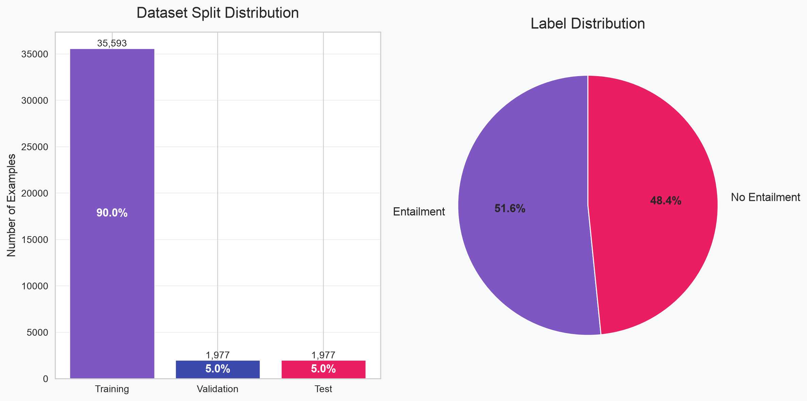
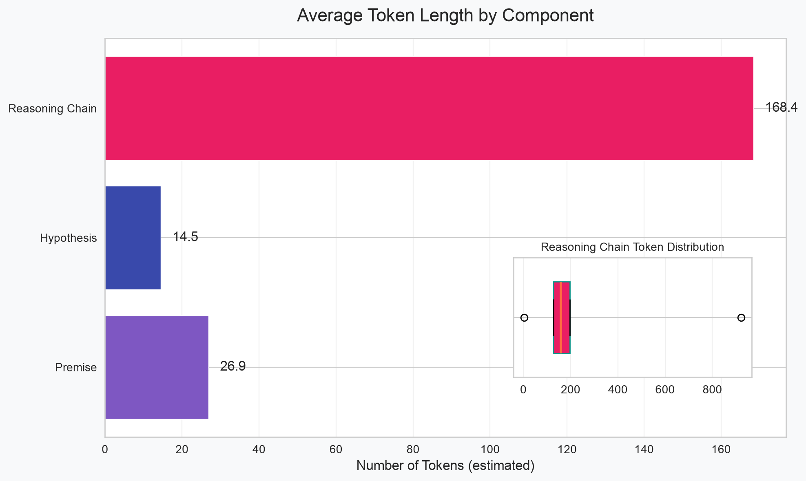
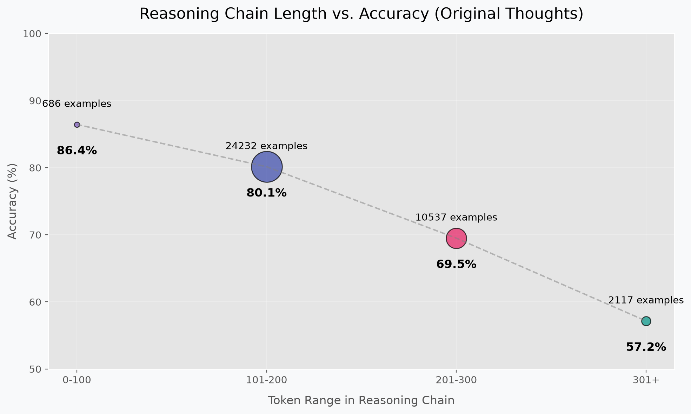

---
language:
- en
license: apache-2.0
task_categories:
- text-classification
tags:
- natural-language-inference
- nli
- chain-of-thought
- synthetic
pretty_name: Mistral NLI Thoughts
size_categories:
- 10K<n<100K
---

# Mistral NLI Thoughts: binary NLI pairs with chain-of-thought rationales

<div align="center">
  
</div>

## Dataset Description

Premise-hypothesis pairs with binary entailment labels (1 entailment, 0 no-entailment), each paired with a
chain-of-thought (CoT) rationale generated by `open-mistral-7b` and, where that model's label disagreed with
the gold label, a corrected rationale written by `open-mistral-nemo` (12B). The dataset was built to
fine-tune Mistral-7B-v0.3 for NLI with explanations; code and write-up are at
https://github.com/j-d0g/mistral-7b-nli.

- **Task:** binary NLI (entailment / no-entailment) with CoT rationales
- **Language:** English
- **Labelled pairs:** 39,547 (35,593 train, 1,977 dev, 1,977 test), plus 3,302 unlabelled pairs
- **Licence:** Apache 2.0 for the generated rationales and the files in this repository. The underlying
  premise-hypothesis pairs were supplied as university coursework data and are redistributed as received.
- **Origin:** Natural Language Understanding coursework at The University of Manchester, 2025

## Files

Everything lives under the `data/` prefix and mirrors the layout the code expects.

### Source pairs: `data/original_data/`

| File | Rows | Entailment / no-entailment | Role |
|------|-----:|---------------------------:|------|
| `train.csv` | 35,593 | 18,338 / 17,255 | Fine-tuning |
| `dev.csv` | 1,977 | 1,048 / 929 | Validation during training |
| `test.csv` | 1,977 | 1,021 / 956 | Held-out evaluation |
| `submission.csv` | 3,302 | unlabelled | Course hidden test set (inputs only) |
| `sample.csv` | 100 | – | Small sample for smoke tests |

Columns: `premise`, `hypothesis`, `label` (absent in `submission.csv`). The split is 90.0% / 5.0% / 5.0% of
the labelled pairs, and no (premise, hypothesis) pair appears in more than one of the three labelled files.

### Generated rationales: `data/original_thoughts/`

JSON lines with `id`, `premise`, `hypothesis`, `thought_process`, `predicted_label`, `true_label`, `correct`,
produced by `open-mistral-7b` with the prompt in `utils/prompts.py` (`INITIAL_GENERATION_PROMPT`).

| File | Rows | Agree with gold label |
|------|-----:|----------------------:|
| `train_thoughts.json` | 35,597 (four training pairs appear twice) | 27,066 (76.03%) |
| `dev_thoughts.json` | 1,977 | 1,480 (74.86%) |
| `test_thoughts.json` | 1,973 | 1,404 (71.16%) |

### Reflected rationales: `data/reflected_thoughts/`

For every row above where `predicted_label != true_label`, `open-mistral-nemo` was given the premise,
hypothesis, gold label and the flawed rationale and asked to explain the error and write a corrected
rationale (`REFLECTION_PROMPT_TEMPLATE` in `utils/prompts.py`). Fields: `id`, `premise`, `hypothesis`,
`predicted_label` (set to the gold label), `true_label`, `thought_process` (the original, flawed rationale),
`error_analysis`, `improved_thought_process` (the corrected rationale).

| File | Rows |
|------|-----:|
| `train_reflections.json` | 8,531 |
| `dev_reflections.json` | 497 |
| `test_reflections.json` | 570 |

### Fine-tuning files: `data/finetune/`

JSON lines with a single `text` field in Mistral instruction format:

```
<s>[INST] Premise: ...\nHypothesis: ...\n\nUse chain of thought reasoning to determine if the hypothesis is entailed by the premise. Provide your reasoning and the final label (0 or 1) in JSON format: {"thought_process": "...", "predicted_label": ...} [/INST] {"thought_process": "...", "predicted_label": 1}</s>
```

| File | Rows | Contents |
|------|-----:|----------|
| `train_ft.jsonl` | 35,597 | Correct original rationales (27,066) plus reflected rationales (8,531) for every training pair |
| `dev_ft.jsonl` | 1,977 | Same construction for the dev pairs |
| `train_ft_final.jsonl` | 37,571 | `train_ft.jsonl` plus 1,973 test pairs, for training a final model after evaluation. **Models trained on this file must not be evaluated on `test.csv`.** |
| `sample_ft.jsonl` | 113 | Small sample for smoke tests |

### Scored rationales: `data/scored_thoughts/`

`train_gold.json`, `dev_gold.json`, `train_silver.json`, `dev_silver.json`: outputs of an earlier,
abandoned LLM-as-a-judge scoring stage (`scripts/score_thoughts.py`). They are kept for completeness and are
not used by the fine-tuning files.

## How the data was built

<div align="center">
  
  <p><em>Figure 1: The Reflection-CoT pipeline.</em></p>
</div>

```
original_data/*.csv  ->  original_thoughts/*.json  ->  reflected_thoughts/*.json  ->  finetune/*.jsonl
  (scripts/generate_thoughts.py)  (scripts/generate_thoughts_reflected.py)  (scripts/prepare_ft_data.py)
```

1. **Initial CoT generation.** `open-mistral-7b` was prompted to reason in about three short steps and answer
   as JSON. The prompt was revised to ask for brevity after an analysis showed that agreement with the gold
   label fell as the rationale grew longer (see below).
2. **Error identification.** Rows whose predicted label differed from the gold label were flagged: 8,531 of
   35,597 training rows (23.97%).
3. **Reflection-CoT.** `open-mistral-nemo` rewrote the rationale for each flagged row, given the gold label
   and the original reasoning.
4. **Assembly.** `prepare_ft_data.py` combined the correct original rationales with the reflected ones into
   `train_ft.jsonl` and `dev_ft.jsonl`.

<div align="center">
  
  <p><em>Figure 2: The Reflection-CoT step.</em></p>
</div>

## Dataset Statistics

<div align="center">
  
  <p><em>Figure 3: Split sizes and label balance of the labelled pairs (from `metrics/card_metrics.json`).</em></p>
</div>

| Metric | Value |
|--------|------:|
| Labelled pairs | 39,547 |
| Training | 35,593 (90.0%) |
| Validation | 1,977 (5.0%) |
| Test | 1,977 (5.0%) |
| Entailment | 20,407 (51.6%) |
| No-entailment | 19,140 (48.4%) |
| Training rationales rewritten by reflection | 8,531 of 35,597 (23.97%) |

### Length statistics

Lengths are estimated as characters / 4 (`scripts/analysis/analyze_token_lengths.py` over `train_ft.jsonl`,
`dev_ft.jsonl` and `test.csv`), not with the Mistral tokenizer.

<div align="center">
  
  <p><em>Figure 4: Average estimated token length by component, with the distribution of reasoning-chain lengths inset.</em></p>
</div>

| Component | Average | Min | Max | Median | 1st quartile | 3rd quartile |
|-----------|--------:|----:|----:|-------:|-------------:|-------------:|
| Premise | 26.88 | 0 | 340 | 23 | 14 | 36 |
| Hypothesis | 14.51 | 0 | 71 | 13 | 9 | 18 |
| Reasoning chain | 168.39 | 4 | 921 | 158 | 128 | 196 |

### Rationale length versus agreement with the gold label

For the `open-mistral-7b` rationales on the training and dev pairs (37,574 rows;
`scripts/analysis/analyze_original_thoughts.py`, output in `metrics/original_token_vs_accuracy.json`):

<div align="center">
  
  <p><em>Figure 5: Agreement between the generated label and the gold label by estimated rationale length.</em></p>
</div>

| Estimated tokens | Rows | Agreement with gold |
|------------------|-----:|--------------------:|
| 0-100 | 686 | 86.44% |
| 101-200 | 24,232 | 80.14% |
| 201-300 | 10,537 | 69.50% |
| 301+ | 2,117 | 57.16% |

Longer rationales agree with the gold label less often. This is a correlation on generated data: harder pairs
may both provoke longer reasoning and be labelled less consistently.

## Models trained on this data

Three QLoRA adapters for Mistral-7B-v0.3 are at
[`jd0g/nlistral-7b-qlora`](https://huggingface.co/jd0g/nlistral-7b-qlora); the best reaches 89.58% accuracy
and 89.57% macro-F1 on `test.csv`, against 53.77% / 41.51% for the zero-shot base model. Per-example
predictions are in [`jd0g/nlistral-7b-results`](https://huggingface.co/datasets/jd0g/nlistral-7b-results).

## Considerations for Using the Data

### Label subjectivity

Manual review of pairs where `open-mistral-7b` disagreed with the gold label found many "no-entailment"
labels that a reasonable reader might call entailment. On the training split the generated labels had 90.71%
precision but 59.58% recall for the entailment class. The reflected rationales are deliberately written to
reach the gold label, so they encode the dataset's labelling conventions, including any inconsistencies.

### Other limitations

1. English only.
2. The rationales reflect the reasoning style and biases of `open-mistral-7b` and `open-mistral-nemo`.
3. The premise-hypothesis pairs were supplied as coursework data; their original provenance is not
   documented here.
4. `train_ft_final.jsonl` contains test pairs and must not be used when `test.csv` is the evaluation set.

## Usage

```python
import json
import pandas as pd
from huggingface_hub import hf_hub_download

REPO = "jd0g/Mistral-NLI-Thoughts"

test = pd.read_csv(hf_hub_download(REPO, "data/original_data/test.csv", repo_type="dataset"))
print(len(test), test.label.value_counts().to_dict())

with open(hf_hub_download(REPO, "data/finetune/train_ft.jsonl", repo_type="dataset")) as f:
    rows = [json.loads(line) for line in f]
print(len(rows))
print(rows[0]["text"][:400])
```

To download everything into the layout the code expects, run `python data/download_data.py` from the code
repository.

## Citation

```bibtex
@misc{tran2025mistralnlithoughts,
  author = {Jordan Tran},
  title = {Mistral NLI Thoughts: binary NLI pairs with chain-of-thought rationales},
  year = {2025},
  publisher = {Hugging Face},
  howpublished = {\url{https://huggingface.co/datasets/jd0g/Mistral-NLI-Thoughts}}
}
```

*This dataset was created as part of a Natural Language Understanding coursework at The University of
Manchester. Generative AI tools were used to help with code refactoring, visualisations and documentation.*
