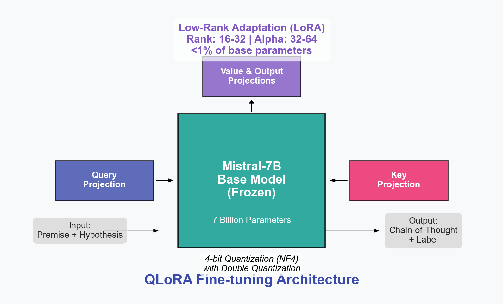
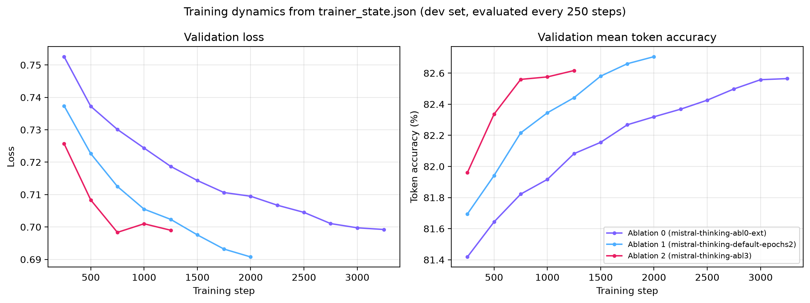

# Model Card: Mistral-7B-v0.3 QLoRA adapters for NLI with chain-of-thought

LoRA adapters that fine-tune `mistralai/Mistral-7B-v0.3` for binary Natural Language Inference (NLI). Given a
premise and a hypothesis, the model writes a short chain-of-thought (CoT) rationale and then a label:
1 for entailment, 0 for no-entailment, as a JSON object.

Code, data pipeline and full write-up: https://github.com/j-d0g/mistral-7b-nli

## Model Details

- **Developed by:** Jordan Tran, as coursework at The University of Manchester
- **Model type:** Causal language model with LoRA adapters, trained for NLI with CoT output
- **Base model:** [`mistralai/Mistral-7B-v0.3`](https://huggingface.co/mistralai/Mistral-7B-v0.3) (Jiang et al., 2023, [arXiv:2310.06825](https://arxiv.org/abs/2310.06825))
- **Fine-tuning method:** QLoRA (4-bit NF4 quantised base weights with double quantisation; LoRA on `q_proj`, `k_proj`, `v_proj`, `o_proj`)
- **Language:** English
- **Licence:** Apache 2.0 (adapters and code); the base model is Apache 2.0

<div align="center">
  
  <p><em>Figure 1: QLoRA: 4-bit quantised base model weights with trainable low-rank adapters.</em></p>
</div>

This repository holds three adapters, one per ablation, in subfolders:

| Subfolder | Config in the code repository | Effective batch | LoRA rank / alpha | Learning rate | Epochs |
|-----------|-------------------------------|----------------:|------------------:|--------------:|-------:|
| `nlistral-7b-qlora-ablation0-best` | `train/configs/ablation0_best.py` | 16 (8 x 2) | 16 / 32 | 2e-4 | 2 |
| `nlistral-7b-qlora-ablation1-best` | `train/configs/ablation1_best.py` | 32 (16 x 2) | 16 / 32 | 2e-4 | 2 |
| `nlistral-7b-qlora-ablation2-best` | `train/configs/ablation2_best.py` | 64 (16 x 4) | 32 / 64 | 5e-5 | 5 |

`nlistral-7b-qlora-ablation1-best` is the best adapter on the held-out test set and the one to use by default.

## Training Details

### Training Data

The training data is the `data/` folder of the dataset
[`jd0g/Mistral-NLI-Thoughts`](https://huggingface.co/datasets/jd0g/Mistral-NLI-Thoughts): 35,593 labelled
premise-hypothesis pairs (`original_data/train.csv`), each with a CoT rationale, formatted for fine-tuning in
`finetune/train_ft.jsonl` (35,597 rows; four pairs appear twice). The dev split (`dev.csv`, 1,977 pairs) is
used for validation loss and early stopping; the test split (`test.csv`, 1,977 pairs) is held out.

<div align="center">
  
  <p><em>Figure 2: The Reflection-CoT pipeline: initial CoT generation, error identification, reflection-based correction.</em></p>
</div>

The rationales were produced in two stages:

1. **Initial CoT generation:** `open-mistral-7b` (Mistral API) wrote a rationale and label for every pair. On
   the training split 27,066 of 35,597 (76.03%) agreed with the gold label.
2. **Reflection-CoT:** for the 8,531 training pairs (23.97%) where the label disagreed, `open-mistral-nemo`
   (12B) was given the premise, hypothesis, gold label and the flawed rationale, and wrote a corrected
   rationale that reaches the gold label.

The fine-tuning file combines the correct original rationales with the reflected ones, so every training pair
is covered. Each row is a Mistral-format `[INST] ... [/INST]` prompt followed by the JSON answer.

### Training Procedure

Training uses `trl`'s `SFTTrainer` with `paged_adamw_8bit`, bfloat16 compute, a cosine learning-rate
schedule with warm-up, `max_seq_length=512`, evaluation and checkpointing every 250 steps, early stopping
with patience 3 on validation loss, and the best checkpoint kept (`train/train_sft.py`).

#### Training Hyperparameters

| Parameter | Ablation 0 (`ablation0_best.py`) | Ablation 1 (`ablation1_best.py`) | Ablation 2 (`ablation2_best.py`) |
|-----------|---------------------------------:|---------------------------------:|---------------------------------:|
| Per-device batch size | 8 | 16 | 16 |
| Gradient accumulation | 2 | 2 | 4 |
| Effective batch size | 16 | 32 | 64 |
| Learning rate | 2e-4 | 2e-4 | 5e-5 |
| LoRA rank / alpha / dropout | 16 / 32 / 0.05 | 16 / 32 / 0.05 | 32 / 64 / 0.05 |
| Epochs | 2 | 2 | 5 |
| Warm-up ratio | 0.03 | 0.03 | 0.05 |
| Gradient checkpointing | off | on | on |
| Gradient clipping | none | none | 1.0 |
| Weight decay | 0.01 | 0.01 | 0.01 |
| Max sequence length | 512 | 512 | 512 |

The `ablation2.py` configuration (learning rate 1e-4, 3 epochs, warm-up ratio 0.10) is the one behind the
ablation 2 test result below; `ablation2_best.py` was trained on `finetune/train_ft_final.jsonl`, which merges
the test pairs into training, so it is reported only on the dev split. The training logs also show that the
ablation 0 and ablation 2 runs saw about 27,200 training rows per epoch rather than the 35,597 in
`train_ft.jsonl`; that intermediate training file was not published. The ablation 1 run used the full file.

#### Training logs and runtime

Full training runs with checkpoints and `trainer_state.json` logs are in
[`jd0g/Mistral-7B-NLI-v0.3`](https://huggingface.co/jd0g/Mistral-7B-NLI-v0.3). The runs behind the published
results and their recorded wall-clock times (`train_results.json`):

| Result | Run | Steps | Training time |
|--------|-----|------:|--------------:|
| Ablation 0 | `mistral-thinking-abl0-ext` | 3,402 | 3.5 h (12,587 s) |
| Ablation 1 | `mistral-thinking-default-epochs2` | 2,224 | not recorded (the run was resumed; `train_results.json` reflects only the resumption) |
| Ablation 2 (test) | `mistral-thinking-abl3` | 1,275 | 4.8 h (17,374 s) |
| Ablation 2 (dev, `ablation2_best.py`) | `mistral-thinking-abl3-final` | 2,935 | 9.3 h (33,647 s) |

Adapter file size (`adapter_model.safetensors`): 591 MB for the rank-16 adapters and 646 MB for rank 32; the
tokenizer files add about 4 MB. Inference with the 4-bit base model fits in 16 GB of GPU memory.

<div align="center">
  
  <p><em>Figure 3: Validation loss and validation mean token accuracy logged every 250 steps for the three runs behind the test results (from the public `trainer_state.json` files; `scripts/analysis/plot_training_dynamics.py`).</em></p>
</div>

## Evaluation

### Testing Data

The held-out split `original_data/test.csv`: 1,977 pairs (1,021 entailment, 956 no-entailment). No pair in
it appears in the training or dev files. Per-example predictions for every evaluated run are in the dataset
[`jd0g/nlistral-7b-results`](https://huggingface.co/datasets/jd0g/nlistral-7b-results), and
`scripts/analysis/compute_test_metrics.py` in the code repository recomputes the table below from them.

### Results

Precision, recall and F1 are macro-averaged over the two classes.

| Model | Accuracy | Precision | Recall | F1 | MCC |
|-------|---------:|----------:|-------:|---:|----:|
| Mistral-7B-v0.3, zero-shot, no adapter | 53.77% | 60.49% | 52.32% | 41.51% | 0.099 |
| Ablation 0 (`mistral-thinking-abl0-ext`) | 89.23% | 89.21% | 89.25% | 89.22% | 0.785 |
| **Ablation 1 (`mistral-thinking-default-epochs2`)** | **89.58%** | **89.57%** | **89.58%** | **89.57%** | **0.791** |
| Ablation 2 (`mistral-thinking-abl3`, `ablation2.py`) | 89.33% | 89.38% | 89.27% | 89.30% | 0.786 |

Relative to the zero-shot base model, ablation 1 improves accuracy by 35.81 percentage points (66.60%
relative) and macro-F1 by 48.06 percentage points (115.78% relative). The base model predicted entailment for
94% of pairs, which is why its F1 and MCC are so low.

Dev-split accuracy: ablation 0 89.07%, ablation 1 88.77%, `ablation2_best.py` run 88.72%.

### Accuracy by length of the generated rationale

Bucketing the ablation 1 test outputs by the estimated length of the rationale (characters / 4;
`scripts/analysis/analyze_finetuned_results.py`):

| Estimated tokens | Test examples | Accuracy |
|------------------|--------------:|---------:|
| 0-100 | 155 | 83.87% |
| 101-200 | 1,549 | 90.12% |
| 201-300 | 250 | 92.40% |
| 301+ | 23 | 60.87% |

For comparison, the agreement of the teacher model's (`open-mistral-7b`) rationales with the gold labels on
the training and dev pairs fell steadily with length (86.44%, 80.14%, 69.50%, 57.16% for the same buckets).
The two analyses are on different data and different models, so they are not a per-bucket measure of the gain
from fine-tuning.

### Unofficial course hidden-test result

The course's hidden test set (3,302 pairs, inputs in `original_data/submission.csv`) was scored by the course
staff after the deadline, unofficially, because the wrong predictions file had been submitted through the
official channel: accuracy 0.9667, weighted F1 0.9667, macro F1 0.9666, macro precision 0.9670, macro recall
0.9664, weighted precision 0.9668, MCC 0.9334. The hidden labels are not public, so this cannot be recomputed.

## Bias, Risks, and Limitations

1. **Domain:** The model is trained on one binary NLI corpus and may not transfer to other domains or to
   three-way (entailment / neutral / contradiction) NLI.
2. **Label subjectivity:** Manual review of pairs where the teacher model disagreed with the gold label found
   many "no-entailment" labels that a reasonable reader might call entailment. The teacher model's labels had
   90.71% precision but 59.58% recall for entailment on the training split. The training data deliberately
   aligns the rationales to the gold labels, so the model reproduces the dataset's labelling conventions,
   including any inconsistencies.
3. **Long rationales:** Accuracy is lower for the few test examples where the model writes more than about 300
   estimated tokens (60.87% on 23 examples).
4. **Output format:** The model is trained to answer with a JSON object; downstream code should still validate
   it (see `evaluate/parse_predictions.py`).

## How to use

### Loading an adapter from the Hub

The adapter repository is gated; request access on its page and pass a token.

```python
import os
import json
import torch
from transformers import AutoModelForCausalLM, AutoTokenizer, BitsAndBytesConfig
from peft import PeftModel, PeftConfig 
from dotenv import load_dotenv

# --- Configuration ---
HUB_REPO_ID = "jd0g/nlistral-7b-qlora"
ADAPTER_NAME_ON_HUB = "nlistral-7b-qlora-ablation1-best" # This is the subfolder name on the Hub
GPU_ID = 0
# ---

load_dotenv()
HF_TOKEN = "YOUR HF TOKEN HERE"

# Download adapter_config.json from the subfolder on the Hub
adapter_config = PeftConfig.from_pretrained(HUB_REPO_ID, subfolder=ADAPTER_NAME_ON_HUB, token=HF_TOKEN)
BASE_MODEL_ID = adapter_config.base_model_name_or_path


#  Configure 4-bit quantization
quantization_config = BitsAndBytesConfig(
    load_in_4bit=True,
    bnb_4bit_compute_dtype=torch.bfloat16,
    bnb_4bit_use_double_quant=True,
    bnb_4bit_quant_type="nf4"
)

# Load the base model with quantization
print(f"Loading base model '{BASE_MODEL_ID}' with 4-bit quantization on GPU {GPU_ID}...")
base_model = AutoModelForCausalLM.from_pretrained(
    BASE_MODEL_ID,
    quantization_config=quantization_config,
    device_map={"": GPU_ID},
    trust_remote_code=True,
    token=HF_TOKEN
)
print("Base model loaded.")

# Load the tokenizer directly from the adapter's location on the Hub
print(f"Loading tokenizer from Hub: '{HUB_REPO_ID}' (subfolder: '{ADAPTER_NAME_ON_HUB}')...")
tokenizer = AutoTokenizer.from_pretrained(
    HUB_REPO_ID,
    subfolder=ADAPTER_NAME_ON_HUB, # Specify the subfolder
    use_fast=True,
    padding_side="left",
    token=HF_TOKEN
)
print("Tokenizer loaded.")

# Resize token embeddings if necessary
if len(tokenizer) != base_model.config.vocab_size:
    print(f"Resizing token embeddings of base model from {base_model.config.vocab_size} to {len(tokenizer)}.")
    base_model.resize_token_embeddings(len(tokenizer))

# Apply the PEFT adapter to the base model, loading adapter weights from the Hub
print(f"Applying PEFT adapter '{ADAPTER_NAME_ON_HUB}' from Hub to the base model...")
model = PeftModel.from_pretrained(
    base_model,
    HUB_REPO_ID,
    subfolder=ADAPTER_NAME_ON_HUB,
    token=HF_TOKEN
)
model.eval() # Set the model to evaluation mode
print("PEFT adapter applied. Model is ready.")

# Set pad_token if not already set
if tokenizer.pad_token is None:
    print("Tokenizer pad_token is None. Setting it to eos_token.")
    tokenizer.pad_token = tokenizer.eos_token

# 'model' and 'tokenizer' are now ready for use.
ADAPTER_PATH = f"{HUB_REPO_ID}/{ADAPTER_NAME_ON_HUB}"

print(f"\nModel and tokenizer for '{ADAPTER_PATH}' loaded successfully from Hugging Face Hub.")
```

### Running inference

```python
import os
import json
import torch
import pandas as pd
from transformers import AutoModelForCausalLM, AutoTokenizer, BitsAndBytesConfig

# 1. Define the prompt template
FINETUNE_PROMPT = """Premise: {premise}
Hypothesis: {hypothesis}

Use chain of thought reasoning to determine if the hypothesis is entailed by the premise. Provide your reasoning and the final label (0 or 1) in JSON format: {{"thought_process": "...", "predicted_label": ...}}"""

premise = "The cat is on the rug."
hypothesis = "A feline is on the mat."

formatted_prompt = FINETUNE_PROMPT.format(
    premise=premise,
    hypothesis=hypothesis
)

input_text = f"[INST] {formatted_prompt} [/INST]"


inputs = tokenizer(input_text, return_tensors="pt").to(next(model.parameters()).device)

# Generate
with torch.no_grad():
    output_sequences = model.generate(**inputs, max_new_tokens=256, pad_token_id=tokenizer.eos_token_id)

# Decode and print only the generated part
generated_text = tokenizer.decode(output_sequences[0][inputs["input_ids"].shape[1]:], skip_special_tokens=True)
generated_text
```

**Example Output:**
```JSON
{"thought_process": "step 1: the premise states that the cat is on the rug. a rug is a type of mat, often used for floor coverings. step 2: the hypothesis suggests that a feline is on the mat. since a mat can refer to a rug, and the cat is on the rug, it can be inferred that a feline is on the mat. step 3: based on the logical reasoning and lack of contradictory facts, the hypothesis can be inferred from the premise.", "predicted_label": 1}
```

For batch inference from a CSV file see `evaluate/sample_model.py` and `demo.ipynb` in the code repository.

## Citation

```bibtex
@misc{tran2025nlistral,
  author = {Jordan Tran},
  title = {Mistral-7B-v0.3 QLoRA adapters for NLI with chain-of-thought},
  year = {2025},
  publisher = {Hugging Face},
  howpublished = {\url{https://huggingface.co/jd0g/nlistral-7b-qlora}}
}
```

*This model was developed as part of a Natural Language Understanding coursework at The University of
Manchester. Generative AI tools were used to help with code refactoring, visualisations and documentation.*
