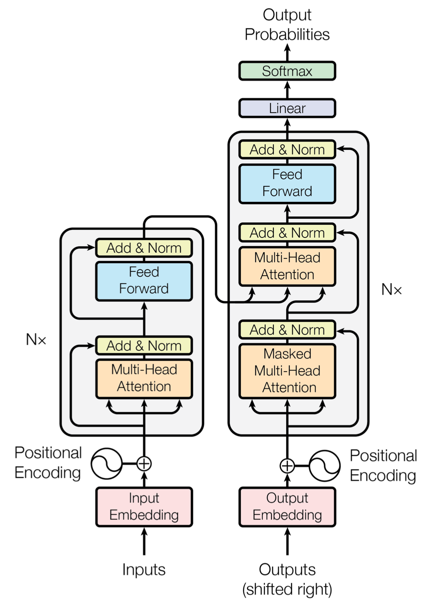
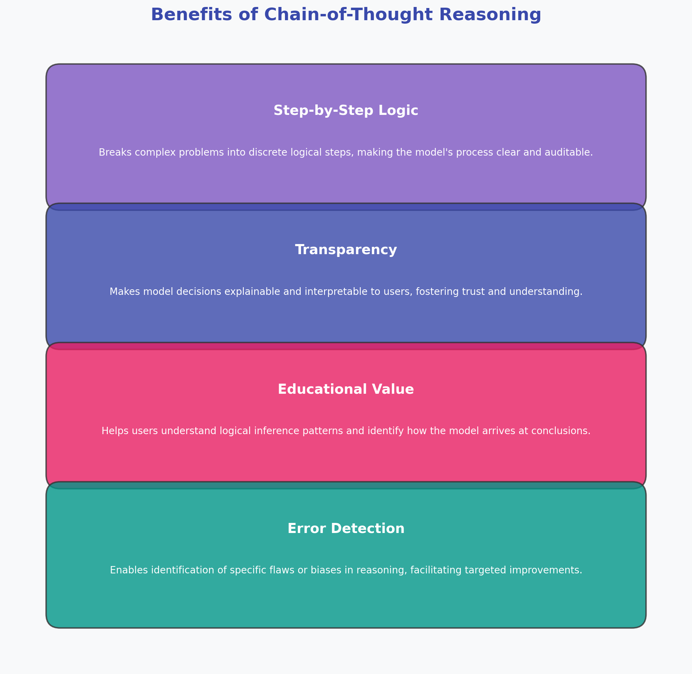
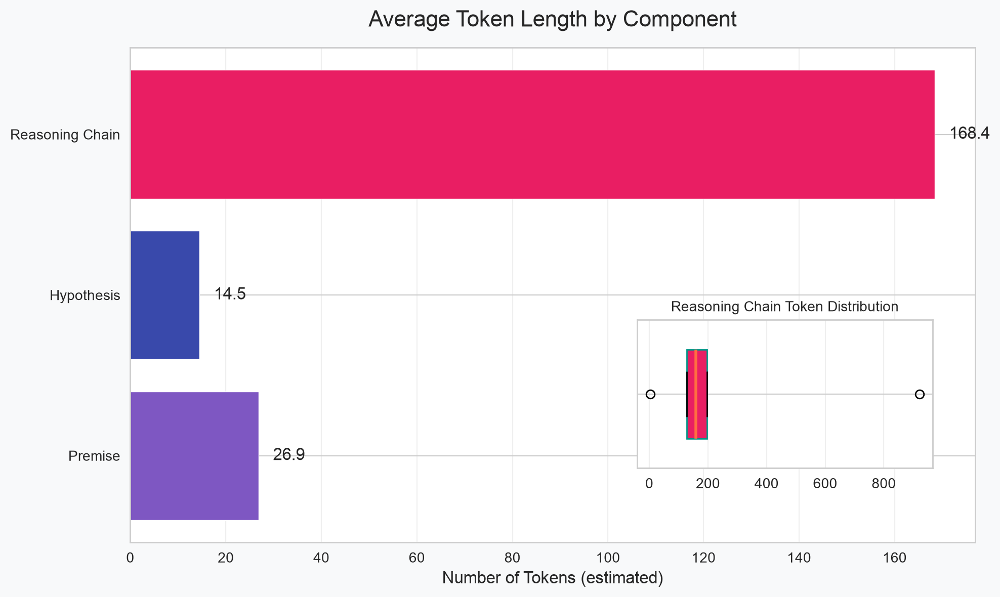
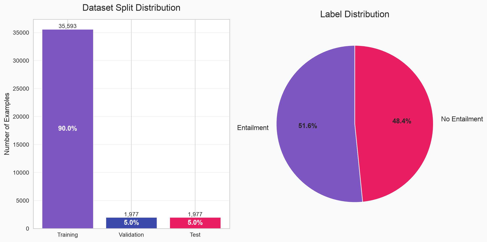
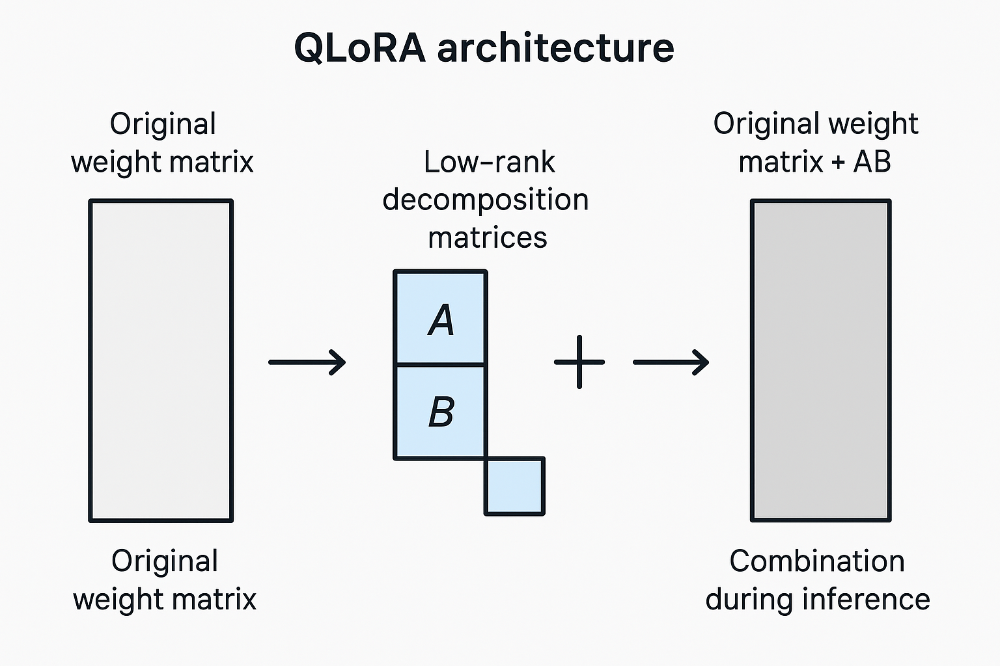
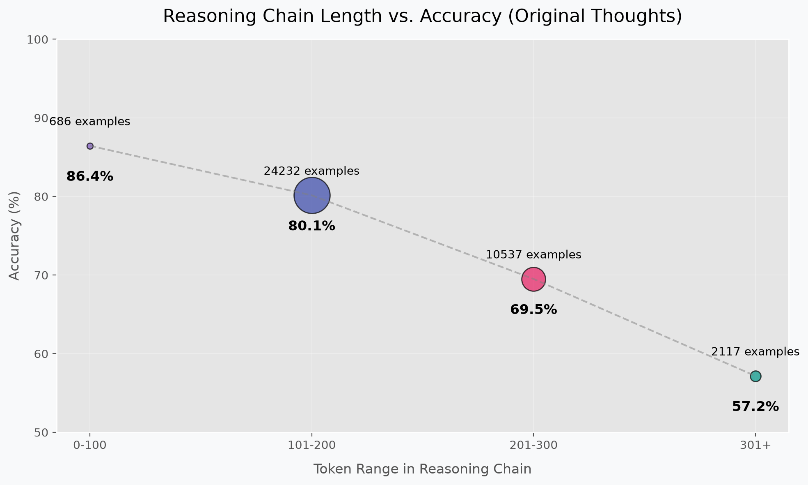
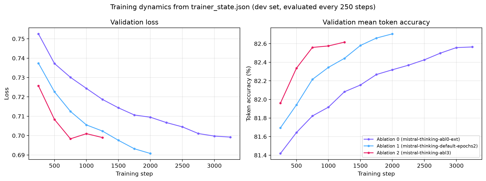
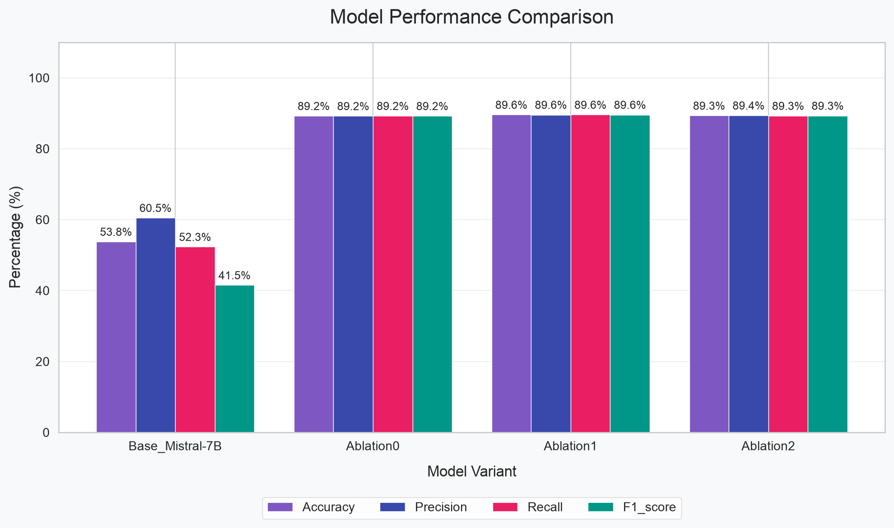
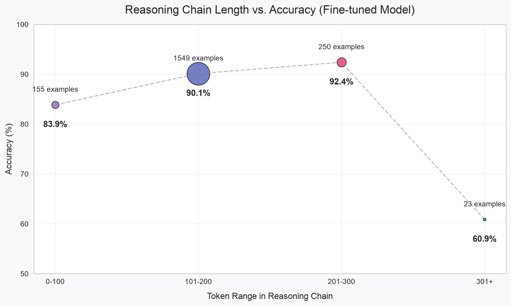

# NLIstral-7B-QLoRA: Interpretable NLI with Augmented Chain-of-Thought Fine-Tuning

## Abstract

This paper details fine-tuning Mistral-7B for Natural Language Inference (NLI) using Chain-of-Thought (CoT) reasoning. We introduce Reflection-CoT, a data augmentation mechanism targeting label disagreement by using a stronger model (`open-mistral-nemo`, 12B) to correct initial CoT errors. This approach yields accurate, interpretable NLI classifications. Parameter-efficient QLoRA fine-tuning combined with our multi-stage data pipeline balances performance, efficiency, and transparency.

## Table of Contents
1. [Introduction and Motivation](#introduction-and-motivation)
   - 1.1. [Problem Statement](#problem-statement)
   - 1.2. [Motivation & Background](#motivation-and-background)
   - 1.3. [Overview of Architecture](#overview-of-architecture)
   - 1.4. [Contributions](#contributions)
2. [Methodology](#methodology)
   - 2.1. [Synthetic Data Augmentation: The Reflection-CoT Pipeline](#synthetic-data-augmentation-the-reflection-cot-pipeline)
   - 2.2. [Model Architecture & Fine-Tuning Strategy](#model-architecture--fine-tuning-strategy)
   - 2.3. [Training Environment and Hyperparameters](#training-environment-and-hyperparameters)
3. [Experiment I - Evolution of Data Augmentation Strategy](#experiment-i---evolution-of-data-augmentation-strategy)
   - 3.1. [Initial Experiments: Learning From Failure](#initial-experiments-learning-from-failure)
   - 3.2. [Less-Is-All-You-Need: Improved Thought Generation](#less-is-all-you-need-improved-thought-generation)
   - 3.3. [LLM-As-A-Judge: Iterative Self-Critique & Improvement](#llm-as-a-judge-iterative-self-critique--improvement)
   - 3.4. [Learn-From-Your-Mistakes: The Adopted Self-Reflection & Correction Mechanism](#learn-from-your-mistakes-the-adopted-self-reflection--correction-mechanism)
   - 3.5. [Final Dataset Composition](#final-dataset-composition)
4. [Experiment II - Fine-Tuning with QLoRA](#experiment-ii---fine-tuning-with-qlora)
   - 4.1. [Dockerized Training Environment Details](#dockerized-training-environment-details)
   - 4.2. [Mistral-7B: 4-bit Quantization Details](#mistral-7b-4-bit-quantization-details)
   - 4.3. [Parameter-Efficient Fine-Tuning with QLoRA: Setup](#parameter-efficient-fine-tuning-with-qlora-setup)
   - 4.4. [Ablation Studies & Hyper-Parameter Tuning](#ablation-studies--hyper-parameter-tuning)
5. [Results](#results)
   - 5.1. [Baseline Performance](#baseline-performance)
   - 5.2. [Fine-Tuned Model Performance](#fine-tuned-model-performance)
   - 5.3. [Comparison to the Base Model](#53-comparison-to-the-base-model)
   - 5.4. [Thought Quality Assessment](#thought-quality-assessment)
   - 5.5. [Results Summary](#results-summary)
6. [Discussion](#discussion)
   - 6.1. [Model Bias and Dataset Considerations](#model-bias-and-dataset-considerations)
   - 6.2. [Labeller Bias and Subjectivity in NLI](#labeller-bias-and-subjectivity-in-nli)
   - 6.3. [Trade-Offs, Assumptions, and Efficiency](#trade-offs-assumptions-and-efficiency)
7. [Limitations and Future Work](#limitations-and-future-work)
   - 7.1. [Current Limitations of Study](#current-limitations-of-study)
   - 7.2. [Proposed Future Work](#proposed-future-work)
      - 7.2.1. [Advanced Reasoning Paradigms (Self-Consistency, Tree-of-Thought)](#advanced-reasoning-paradigms-self-consistency-tree-of-thought)
      - 7.2.2. [RLHF Optimization for Reasoning](#rlhf-optimization-for-reasoning)
      - 7.2.3. [Refining Scoring and LLM-as-a-Judge](#refining-scoring-and-llm-as-a-judge)
      - 7.2.4. [Exploring Full Fine-Tuning](#exploring-full-fine-tuning)
8. [Conclusion](#conclusion)
9. [References](#references)

## Introduction and Motivation

Natural Language Inference (NLI) tests a model's ability to reason about textual relationships. While large language models (LLMs) achieve high NLI accuracy, their decision processes often lack transparency, limiting trust and debuggability. This work addresses this by fine-tuning Mistral-7B to generate interpretable Chain-of-Thought (CoT) reasoning alongside NLI classifications.

### Problem Statement
NLI determines if a "hypothesis" is logically inferable from a "premise." This binary classification (entailment/no-entailment) is challenged by linguistic ambiguity, the need for world knowledge, and complex reasoning. Generating explanatory CoT addresses the opacity of standard NLI models.

### Motivation & Background
CoT prompting, by eliciting step-by-step reasoning, enhances model interpretability and performance on complex tasks like NLI. It allows for error analysis and can mitigate logical fallacies. Mistral-7B was selected for its strong reasoning capabilities within its parameter class and API accessibility (`open-mistral-7b` for initial CoT, `open-mistral-nemo` for reflection), crucial for our data generation strategy.

#### Transformer Architectures for NLI
NLI has often utilized encoder-based (e.g., BERT) or encoder-decoder architectures (e.g., T5), typically encoding premise and hypothesis jointly for direct classification. These models excel at classification but do not natively generate explanatory text.

  
  
<em>Figure: Comparison of encoder-decoder and decoder-only architectures for NLI tasks. While encoder-decoder models excel at classification, decoder-only models like Mistral-7B naturally facilitate step-by-step reasoning generation.</em>

Our use of a decoder-only autoregressive model (Mistral-7B) for CoT-based NLI is justified by its ability to: (1) unify reasoning and classification in a single generative process; (2) produce flexible, structured outputs (e.g., JSON with CoT and label); (3) leverage pre-trained reasoning capabilities; and (4) integrate world knowledge via autoregressive generation. The causal attention mechanism, mathematically $\text{Attention}(Q, K, V) = \text{softmax}\left(\frac{QK^T}{\sqrt{d_k}} + M\right)V$ (where $M$ is the causal mask), is fundamental to CoT, enforcing step-by-step reasoning.

### Overview of Architecture
Our system integrates a multi-stage data augmentation pipeline with parameter-efficient fine-tuning:

1.  **Multi-Stage Data Augmentation (The Reflection-CoT Pipeline):**
    *   **Stage 1: Initial CoT Generation:** All premise-hypothesis pairs are processed by `open-mistral-7b` to generate an initial CoT and predicted label. This captures the baseline reasoning tendencies of a Mistral-7B class model.
    *   **Stage 2: Error Identification & Reflection Trigger:** Examples where the initial prediction from Stage 1 mismatches the dataset's ground-truth label are flagged (23.97% of training pairs: 8,531 of 35,597).
    *   **Stage 3: Reflection-CoT Generation:** For flagged examples, the `open-mistral-nemo` (12B parameter) model is employed. It receives the premise, hypothesis, the *true label*, and the *original flawed CoT from `open-mistral-7b`*. Its task is to analyze the prior error and generate a corrected CoT that leads to the true label. The use of a more powerful 12B model for reflection is crucial, as this meta-reasoning task (analyzing and correcting another model's complex reasoning) requires greater capacity than the initial CoT generation. This specific contextual input guides `open-mistral-nemo` to produce targeted corrections rather than entirely new, potentially unrelated reasoning paths.
    *   **Stage 4: Final Dataset Assembly:** The fine-tuning dataset is composed of (a) examples correctly processed in Stage 1, and (b) examples corrected through the Reflection-CoT mechanism in Stage 3. This ensures comprehensive coverage and high-quality reasoning paths for all original examples.

2.  **Parameter-Efficient Fine-Tuning (PEFT):**
    *   The augmented dataset, rich with CoT examples, is used to fine-tune `mistralai/Mistral-7B-v0.3` using QLoRA. This method involves 4-bit quantization of the base model and training low-rank adapters, enabling efficient tuning on accessible hardware (e.g., single 24GB GPU) by updating only a small fraction of parameters.
    *   Key training aspects include optimized sequence length (512 tokens based on CoT analysis), batching, and learning rate schedules.

  
  
<em>Figure 1: Complete architecture of the NLIstral-7B-QLoRA data generation and fine-tuning pipeline. The process begins with initial CoT generation, followed by error identification, reflection-based correction, and culminates in QLoRA fine-tuning.</em>

### Contributions

Our primary contributions are:

1. The **Reflection-CoT** mechanism: A novel data augmentation approach that addresses label disagreement by providing models with both the correct label and flawed reasoning, enabling targeted correction of logical errors.

2. An empirical analysis of **CoT length and label agreement**: Showing that, in the generated training data, shorter reasoning chains agree with the gold labels more often, which informed both the prompt design and the 512-token training context.

3. A comprehensive case study of **QLoRA fine-tuning for reasoning tasks**: Providing practical insights into hyperparameter selection and training stability for parameter-efficient fine-tuning of reasoning-focused language models.

## Methodology

This section details the technical implementation of our data generation and model fine-tuning processes.

### 2.1. Synthetic Data Augmentation: The Reflection-CoT Pipeline

The core of our NLI fine-tuning data was synthetically generated CoT examples. This section details our proposed **Reflection-CoT** data augmentation pipeline.

#### Initial Thought Generation

For the first stage of our pipeline, we used `open-mistral-7b` to generate CoT reasoning and predicted labels for all premise-hypothesis pairs in our dataset. The model was prompted to:

1. Analyze the premise and hypothesis carefully
2. Generate step-by-step reasoning (encouraged to be brief, typically 3 steps)
3. Provide a final binary label (0 for no-entailment, 1 for entailment)
4. Format the output as JSON: `{"thought_process": "...", "predicted_label": 0|1}`

This process yielded an initial set of CoT examples, 76.03% of which matched the dataset's gold standard labels on the training split (27,066 of 35,597; `data/original_thoughts/train_thoughts.json`) and 74.86% on the dev split (1,480 of 1,977). We chose Mistral-7B for this stage based on empirical observations that its concise reasoning patterns often aligned better with the dataset's binary labels compared to larger models that sometimes "overthought" examples, particularly for subjective cases.

The choice to capture the base model's "natural" reasoning before any correction was deliberate—it provided a baseline understanding of the model's approach and would potentially minimize friction between the base model and the fine-tuned LoRA adapter by preserving reasoning patterns the model was already comfortable with.

#### Chain-of-Thought as Pre-Label Alignment

A key insight in our approach is viewing Chain-of-Thought as a form of "pre-label alignment"—a process that guides the model's internal representations toward the correct classification before it produces a label. This differs from traditional fine-tuning, where the model is directly optimized for label accuracy without explicit reasoning.

By training the model to generate reasoning paths that lead to specific labels, we:

1. **Constrain the solution space**: The model must follow a logical path to the label rather than learning arbitrary correlations
2. **Enable verification**: Each step in the reasoning can be verified independently
3. **Facilitate human intervention**: Points of disagreement can be precisely identified within the reasoning chain

This pre-label alignment is particularly valuable in cases where label subjectivity might otherwise lead to confusion or inconsistency in the model's learning process.

  
  
<em>Figure 2: Benefits of Chain-of-Thought as pre-label alignment. The reasoning path constrains the solution space, enables verification of logical steps, and provides opportunities for targeted human intervention.</em>

#### Reflection on Errors: The Reflection-CoT Mechanism

A core component of our methodology is the **Reflection-CoT mechanism**, designed to address instances where the initial CoT generation by `open-mistral-7b` yielded predictions inconsistent with the provided dataset labels (23.97% of training pairs, 8,531 of 35,597).

**Addressing Label Disagreement & Limitations of Automated Correction:** Initial explorations (detailed in experiment logs, `BLOG.md`) into resolving these disagreements by attempting to automatically guide the model towards the correct label without explicit instruction (i.e., "correct naturally" through iterative self-scoring with stronger models) proved both prohibitively expensive (estimated >£100 in API costs for a subset) and largely ineffective. Models often struggled to find coherent, natural reasoning paths to the target label, reinforcing concerns about dataset label subjectivity and the limitations of purely automated refinement in such scenarios.

**Mechanism Design:** Consequently, the Reflection-CoT mechanism employs a more direct approach. For premise-hypothesis pairs where `open-mistral-7b`'s prediction was incorrect, a stronger model, `open-mistral-nemo` (a 12B parameter model), was utilized. The `open-mistral-nemo` model was provided with:
1.  The original premise and hypothesis.
2.  The **true label** from the dataset (acknowledging it as the "gold standard" for the task).
3.  The **original, flawed thought process** generated by `open-mistral-7b`.
The model was then explicitly prompted to analyze the initial mistake and generate a corrected reasoning path that logically leads to the true label.

**Rationale for Stronger Model & Contextual Input:** `open-mistral-nemo` (12B) was chosen over the initial 7B model for reflection due to its enhanced reasoning capabilities, deemed necessary for the meta-reasoning task of identifying logical flaws in another model's output and constructing a sound, corrective argument. Providing the original flawed reasoning as context was a deliberate design choice aimed at:
*   Guiding `open-mistral-nemo` to correct the *specific logical failure* rather than merely generating any valid path to the true label.
*   Addressing the potential for the reflection model to produce forced or unnatural reasoning if only given the target label, especially given the observed subjectivity of some dataset labels.
*   Encouraging the reflection model to potentially emulate the concise style of the initial CoT, having seen an example (albeit flawed).
This process was crucial for systematically handling challenging examples and creating a more robust training set by learning from initial model failures.

#### Prompt Engineering

Significant effort was invested in prompt design for both generation and reflection:
*   **Structure:** Utilized Markdown and XML tags for clarity.
*   **Output Format:** Enforced JSON output (`{"thought_process": "...", "predicted_label": ...}`) using few-shot examples in the prompt.
*   **CoT Guidance:** Instructions for step-by-step reasoning, refined to encourage brevity and a 3-step structure, which correlated with higher accuracy and efficiency. In the experiment notes this refinement raised agreement with the gold labels from roughly 65% to roughly 75%; the final prompt's agreement on the training split is 76.03%. The outputs of the earlier prompt are not in the repository, so the 65% starting point cannot be reproduced from files.
*   **Reflection Prompt:** Specifically asked the model to analyze the prior (incorrect) thought process and generate a corrected one.

#### Final Dataset Composition and Characteristics

The fine-tuning dataset was constructed by:
*   Including examples where the initial `open-mistral-7b` generation was correct.
*   Including examples where the initial generation was incorrect but were subsequently corrected through the reflection process with `open-mistral-nemo` (12B).

This strategy aimed to leverage the strengths of both models and ensure the fine-tuning dataset covered the full range of original NLI examples with the best available reasoning for each.

Based on our analysis of the final dataset, we identified the following key characteristics:

1. **Size and Distribution**: The labelled data consists of 39,547 pairs: 35,593 training pairs (90.0%), 1,977 validation pairs (5.0%) and 1,977 test pairs (5.0%), in `data/original_data/{train,dev,test}.csv`. No (premise, hypothesis) pair appears in more than one split. Labels are balanced: 20,407 entailment (51.60%) and 19,140 no-entailment (48.40%). The fine-tuning file `data/finetune/train_ft.jsonl` has 35,597 rows (four training pairs appear twice in the generated rationales).

2. **Token Length Analysis**: As shown in Figure 3, the reasoning chains are several times longer than the inputs. Lengths are estimated as characters / 4 (`scripts/analysis/analyze_token_lengths.py` over `train_ft.jsonl`, `dev_ft.jsonl` and `test.csv`), not with the Mistral tokenizer:

  
  
<em>Figure 3: Average estimated token length of premises, hypotheses and reasoning chains, with the distribution of reasoning-chain lengths inset.</em>

| Component | Average (est. tokens) | Min | Max | Median | 1st Quartile | 3rd Quartile |
|-----------|----------------------:|----:|----:|-------:|-------------:|-------------:|
| Premise | 26.88 | 0 | 340 | 23 | 14 | 36 |
| Hypothesis | 14.51 | 0 | 71 | 13 | 9 | 18 |
| Reasoning Chain | 168.39 | 4 | 921 | 158 | 128 | 196 |

3. **Reflection Impact**: 23.97% of the training file (8,531 of 35,597 rows) carries reasoning rewritten through the Reflection-CoT mechanism; the remaining 76.03% keeps the original `open-mistral-7b` reasoning.

4. **Thought Length Distribution**: 64.5% of the original reasoning chains (24,232 of 37,574 train and dev rationales) fall in the 101-200 estimated-token range, consistent with the prompt's emphasis on three concise steps.

The dataset composition deliberately balances between preserving the model's natural reasoning patterns (from correct initial generations) and learning from corrected errors (via the Reflection-CoT mechanism), creating a rich training resource for interpretable NLI.

  
  
<em>Figure 4: Composition of the final dataset showing distribution by data source (original vs. reflection-corrected) and label balance.</em>

### 2.2. Model Architecture & Fine-Tuning Strategy

#### Base Model: Mistral-7B

The base model for fine-tuning was `mistralai/Mistral-7B-v0.3`.

**Rationale:** Chosen for its strong performance-to-cost ratio, good reasoning capabilities within its size class, fast inference speed, and the availability of an API ecosystem that facilitated the multi-stage data generation process.

#### Parameter-Efficient Fine-Tuning (PEFT) with QLoRA

QLoRA was employed for fine-tuning to manage memory constraints.

**Quantization:** The base Mistral-7B model weights were loaded in 4-bit precision using NF4 ("NormalFloat 4") via `bitsandbytes`. Double quantization was used for further memory savings. Mathematically, for a weight tensor $W$, NF4 quantization $W_q$ can be expressed as: $W_q = \text{round}\left(\frac{W - \mu}{\sigma} \cdot s\right) \cdot \frac{\sigma}{s} + \mu$, where $\mu, \sigma$ are mean/std.dev and $s$ is a scaling factor.

**LoRA (Low-Rank Adaptation):** Small, trainable adapter matrices ($B \in \mathbb{R}^{m \times r}, A \in \mathbb{R}^{r \times n}$) were injected into the attention mechanism's linear layers (`q_proj`, `k_proj`, `v_proj`, `o_proj`) of the frozen, quantized base model. The weight update is $\Delta W = BA$. The effective weights become $W' = W + \alpha \cdot BA$. Only $A$ and $B$ are trained.

**Key QLoRA Parameters:**
*   `lora_r` (rank): Typically 16 or 32 in experiments.
*   `lora_alpha` (scaling): Typically `2 * r`.
*   `lora_dropout`: e.g., 0.05.

The implementation of QLoRA follows the architecture described in Dettmers et al. (2023), with the base model layers quantized to 4-bit precision and the trainable LoRA adapters injected into the attention mechanism. This hybrid approach maintains the knowledge encoded in the base model while allowing targeted adaptation of reasoning capabilities.

  
  
<em>Figure 5: QLoRA combines 4-bit quantization of the base model weights with trainable low-rank adaptation matrices (A and B), so only a small fraction of the parameters is updated.</em>

### 2.3. Training Environment and Hyperparameters

#### Environment and Configuration

To ensure consistency and reproducibility across different hardware environments, we developed a Dockerized training environment. This approach was crucial given the complex dependencies between specific versions of CUDA, PyTorch, and various libraries like PEFT, TRL, and bitsandbytes.

#### Key Hyperparameters and Optimizations

*   **Epochs:** Typically 2-5, with early stopping based on validation loss plateauing for 3 consecutive evaluations.
*   **Batch Size:** Effective batch sizes varied (e.g., 16, 32, 64) using `per_device_train_batch_size` and `gradient_accumulation_steps`.
*   **Learning Rate:** The configurations in `train/configs/` use `2e-4` (ablations 0 and 1, effective batch 16 and 32), `1e-4` (`ablation2.py`, effective batch 64) and `5e-5` (`ablation2_best.py`), each with a cosine schedule and warm-up. The best test result came from `2e-4` at effective batch 32.
    *   **Warmup Strategy:** The final configurations specify warm-up as a ratio of total steps (`warmup_ratio` 0.03 for ablations 0 and 1, 0.10 and 0.05 for the two ablation 2 configurations); `train/train_sft.py` passes it straight to the trainer. Fixed `warmup_steps` were tried in earlier runs (see `train/configs/archive/`) after warm-up interacted badly with changes to epoch count and with resuming from checkpoints, as described in `BLOG.md`.
*   **Optimizer:** `paged_adamw_8bit` was used for memory efficiency.
*   **Sequence Length:** `max_seq_length` was set to 512 tokens after the length analysis of the generated rationales. Three quarters of reasoning chains are under 196 estimated tokens and the median is 158, so prompt plus rationale fits in 512 tokens for almost all examples; the few longer chains (the longest is about 921 estimated tokens) are truncated by the trainer. The shorter context reduces attention cost and memory, which made larger batch sizes and higher LoRA ranks possible on a 24 GB GPU.
*   **BF16 Handling:** An `autocast` wrapper around the model's forward pass was used to mitigate dtype mismatches when using `bfloat16` precision with gradient checkpointing.
*   **Gradient Checkpointing:** Enabled in `ablation1_best.py` and both ablation 2 configurations to save memory by recomputing activations during the backward pass, at the cost of slower steps. Ablation 0 and `ablation1.py` run without it.

## 3. Experiment I - Evolution of Data Augmentation Strategy

This section details our iterative journey to develop an effective data augmentation strategy for NLI Chain-of-Thought fine-tuning.

### Initial Experiments: Learning From Failure

Our first approach to fine-tuning was naive in several ways. We used a pre-quantized GPTQ version of Mistral-7B with poorly configured hyperparameters and an overly simplistic dataset. This initial dataset suffered from multiple limitations:

1. **Limited Coverage:** We only used examples where `open-mistral-7b` predictions already matched the dataset labels (76.03% of the training pairs with the final prompt), discarding challenging cases.

2. **Data Reduction:** After further filtering to balance label distribution, we trained on only about 10,000 examples (from the experiment notes; this intermediate file is not in the repository).

3. **Confirmation Bias:** By only including examples the model already handled correctly, we reinforced existing patterns without addressing blind spots.

The result was predictable: the model overfit extremely quickly, often within a single epoch, and failed to generalize to more challenging examples. This experience highlighted the critical importance of data quality and diversity in CoT fine-tuning. We needed a more sophisticated data generation approach that could handle the full spectrum of examples, including those where the model initially disagreed with dataset labels.

### Less-Is-All-You-Need: Improved Thought Generation

After our initial failure, we conducted a thorough analysis of the generated thought chains to understand patterns in high-performing versus low-performing examples. This analysis revealed an interesting correlation: the length of the reasoning chain appeared to be strongly associated with accuracy.

Specifically, on the `open-mistral-7b` rationales for the training and dev pairs, agreement with the gold label falls steadily as the reasoning gets longer: from 86% for chains under 100 estimated tokens to 57% for chains over 300 (table below). Manual inspection supported this: shorter chains were typically "concise, simplistic, logical", while longer ones often showed "overthinking" and struggled with examples that had subjective elements.

#### Quantitative Analysis of Reasoning Length vs. Accuracy

To quantify this relationship we bucketed the `open-mistral-7b` rationales for the 37,574 training and dev pairs by estimated length (characters / 4) and measured agreement with the gold label in each bucket (`scripts/analysis/analyze_original_thoughts.py`, output in `metrics/original_token_vs_accuracy.json`). Figure 6 and the table show the result:

  
  
<em>Figure 6: Agreement between the `open-mistral-7b` label and the gold label by estimated reasoning-chain length, training and dev pairs. The correlation does not establish causation: harder examples may both provoke longer reasoning and be mislabelled more often.</em>

| Estimated token range | Examples | Agreement with gold | Observation from manual inspection |
|-----------------------|---------:|--------------------:|------------------------------------|
| 0-100 | 686 (1.8%) | 86.44% | Short, direct chains |
| 101-200 | 24,232 (64.5%) | 80.14% | Typical three-step reasoning |
| 201-300 | 10,537 (28.0%) | 69.50% | Reasoning starts to drift |
| 301+ | 2,117 (5.6%) | 57.16% | Overthinking, tangential reasoning |

Each additional 100 estimated tokens beyond the first bucket corresponds to a drop of roughly 10 percentage points in agreement. Agreement over all 37,572 scored rationales is 75.98%.

It's important to note that while we observed this correlation consistently across experiments, we cannot definitively conclude a causal relationship. Other factors may influence both reasoning length and accuracy, such as example complexity, topic domain, or inherent ambiguity in the task. This area would benefit from further controlled research.

Nevertheless, the observed pattern was consistent enough to inform our approach. Based on this analysis, we redesigned our prompts to encourage brevity and structure (typically a 3-step reasoning process). In the experiment notes this raised agreement with the gold labels from roughly 65% to roughly 75% without changing the model; the final prompt's agreement on the training split is 76.03% (the earlier prompt's outputs are not in the repository). This insight later informed the choice of `max_seq_length=512` for fine-tuning.

### LLM-As-A-Judge: Iterative Self-Critique & Improvement

With improved thought generation in place, we still needed to address the 23.97% of training examples (8,531) where our generated thoughts disagreed with dataset labels. Rather than simply discarding these examples, we explored an automated approach to improve them.

We developed an LLM-as-a-judge system (implemented in `scripts/score_thoughts.py`) that would:
1. Score the quality of a generated thought process based on criteria such as coherence, correctness, and alignment with the label
2. For examples scoring below a threshold, attempt to improve the reasoning through iterative refinement
3. Recursively apply this process, potentially escalating to stronger models when necessary

This approach revealed a significant challenge: the `open-mistral-7b` labels had a stark precision-recall imbalance on the training split (for the entailment class, 90.71% precision but 59.58% recall: 10,927 true positives, 1,119 false positives, 7,412 false negatives, 16,139 true negatives). The model under-predicted entailment relative to the gold labels, and many of the disagreements looked, on manual inspection, like pairs the model had reasonably judged.

While promising in concept, this self-improvement approach proved prohibitively expensive (costing >£100 for a subset of examples) and often failed to converge on subjective examples. Despite numerous iterations and model upgrades, some premise-hypothesis pairs simply wouldn't yield a satisfactory agreement with the dataset label.

### Learn-From-Your-Mistakes: The Adopted Self-Reflection & Correction Mechanism

After consulting with university advisors, we confirmed that despite apparent subjectivity in some cases, the dataset should be treated as the "gold standard" for this task. This guidance led to our final and most successful data augmentation approach: the Reflection-CoT mechanism.

Rather than trying to coax models into naturally arriving at potentially counterintuitive labels or discarding challenging examples, we embraced a more direct approach:

1. For examples where the initial prediction was incorrect, we provided a stronger model (`open-mistral-nemo`, a 12B parameter model) with:
   - The original premise and hypothesis
   - The true label from the dataset 
   - The original, flawed thought process

2. We explicitly prompted `open-mistral-nemo` (12B) to:
   - Analyze why the initial reasoning led to an incorrect conclusion
   - Identify the specific logical flaws or oversights
   - Generate a corrected reasoning path that logically leads to the true label

This approach was superior to simply asking a model to generate reasoning for a given label from scratch because:
- It specifically addressed the flaws in the original reasoning rather than generating any arbitrary path to the label
- It preserved the style and approach of the original CoT while fixing only what was necessary
- It created more natural, grounded corrections than might emerge from forcing a model to justify a label it disagreed with
- It avoided potential hallucination that might occur when a model was asked to support a conclusion that seemed counterintuitive to it

Manual inspection of a random sample of these reflections confirmed they effectively identified and corrected flaws in the original reasoning while maintaining consistency in style and approach.

  
  
<em>Figure 7: The Reflection-CoT process showing how incorrect initial reasoning is analyzed and corrected by a stronger model to create high-quality training examples for fine-tuning.</em>

### Final Dataset Composition

Our final fine-tuning dataset combined:
1. Examples where the initial `open-mistral-7b` generation produced the correct label and reasoning
2. Examples where the initial generation was incorrect but were corrected through our Reflection-CoT process (using `open-mistral-nemo`, 12B)

This approach raised the usable training data from the 27,066 pairs whose initial rationale was correct to all 35,597, restored the gold-label class balance, and ensured coverage of the full spectrum of examples, including the challenging ones.

## 4. Experiment II - Fine-Tuning with QLoRA

After developing our data augmentation pipeline, we turned to the technical challenges of fine-tuning Mistral-7B on this data efficiently.

### Dockerized Training Environment Details

To ensure consistency and reproducibility across different hardware environments, we developed a Dockerized training environment. This approach was crucial given the complex dependencies between specific versions of CUDA, PyTorch, and various libraries like PEFT, TRL, and bitsandbytes.

### Mistral-7B: 4-bit Quantization Details

Full fine-tuning of a 7B parameter model requires substantial GPU memory and computational resources. To make this process more accessible, we employed 4-bit quantization via the bitsandbytes library:

1. **NF4 Data Type:** The "NormalFloat 4" format provides a good balance between compression and representational capacity.
2. **Double Quantization:** For further memory reduction, we quantized both the weights and the quantization constants themselves.
3. **BFloat16 Computation:** While weights were stored in 4-bit precision, actual forward/backward computations used BFloat16 for stability.

This quantization strategy reduced the memory footprint by approximately 75% compared to FP16 training, making it possible to fine-tune on consumer GPUs with 24GB of VRAM.

### Parameter-Efficient Fine-Tuning with QLoRA: Setup

Building on the quantized model, we implemented Low-Rank Adaptation (LoRA) to further increase parameter efficiency:

1. **Target Modules:** We applied LoRA to the query, key, value, and output projection matrices in the attention mechanism (`q_proj`, `k_proj`, `v_proj`, `o_proj`).
2. **Rank and Alpha:** We experimented with different rank values (typically `r=16` or `r=32`) and scaling factors (`lora_alpha=32` or `lora_alpha=64`), finding that higher ranks were beneficial for capturing the complexity introduced by our reflection data.
3. **Dropout:** A small dropout value (`lora_dropout=0.05`) was applied for regularization.

With adapters on the four attention projections of all 32 layers, rank 16 adds about 13.6M trainable parameters (0.19% of the 7.25B base) and rank 32 about 27.3M (0.38%).

#### Mathematical Formulation of QLoRA

QLoRA combines 4-bit quantization with Low-Rank Adaptation. Here we provide the mathematical foundations for both components.

**4-bit Quantization (NF4):**

The NormalFloat 4-bit (NF4) quantization maps 16-bit or 32-bit floating-point weights to a 4-bit representation following a normal distribution. For each weight tensor $W \in \mathbb{R}^{m \times n}$, the quantization process can be expressed as:

$$W_q = \text{round}\left(\frac{W - \mu}{\sigma} \cdot s\right) \cdot \frac{\sigma}{s} + \mu$$

Where:
- $W_q$ is the quantized weight tensor
- $\mu$ is the mean of the weight values
- $\sigma$ is the standard deviation of the weight values
- $s$ is a scaling factor determined by the NF4 quantization scheme
- $\text{round}(\cdot)$ maps to the nearest 4-bit representable value

For double quantization, the quantization constants themselves are further quantized to 8 bits, reducing memory requirements further.

**Low-Rank Adaptation (LoRA):**

In standard fine-tuning, we would update the full weight matrices $W$ of the model. With LoRA, for each weight matrix $W \in \mathbb{R}^{m \times n}$ that we want to adapt, we instead introduce a low-rank decomposition:

$$\Delta W = BA$$

Where:
- $B \in \mathbb{R}^{m \times r}$ and $A \in \mathbb{R}^{r \times n}$ are the LoRA adaptation matrices
- $r$ is the rank hyperparameter ($r \ll \min(m, n)$)

During forward propagation, instead of using the original weights $W$, we use:

$$W' = W + \alpha \cdot \Delta W = W + \alpha \cdot BA$$

Where:
- $\alpha$ is a scaling factor (typically set to $\alpha = 2 \cdot r$)
- The original weights $W$ remain frozen (and quantized in QLoRA)
- Only $A$ and $B$ are updated during training

This approach dramatically reduces the number of trainable parameters from $m \times n$ to $r \times (m + n)$, which is especially significant for large matrices in transformer models.

### Ablation Studies & Hyper-Parameter Tuning

We conducted several ablation studies to identify optimal training parameters:

1. **Batch Size and Learning Rate:**
   - **Ablation 0 (Small Batch):** Effective batch size 16, `lr=2e-4`, 2 epochs
   - **Ablation 1 (Medium Batch):** Effective batch size 32, `lr=2e-4`, 2 epochs, with gradient checkpointing
   - **Ablation 2 (Large Capacity/Batch):** Effective batch size 64, LoRA rank 32, gradient clipping at 1.0. `ablation2.py` uses `lr=1e-4` for 3 epochs; `ablation2_best.py` lowers this to `lr=5e-5` for 5 epochs.

2. **Sequence Length:** Based on our token analysis, we set `max_seq_length=512` in every configuration (see Section 2.3).

3. **Warmup Strategy:** The final configurations use `warmup_ratio` (0.03 to 0.10); fixed `warmup_steps` were tried in earlier archived configurations when resuming and re-scheduling runs proved fragile.

The key hyperparameters for our best-performing configuration (`train/configs/ablation1_best.py`) are:

| Parameter | Value | Notes |
|-----------|-------|-------|
| lora_r | 16 | Rank of the adapter matrices |
| lora_alpha | 32 | Set to 2*r |
| lora_dropout | 0.05 | Light regularisation |
| target_modules | q_proj, k_proj, v_proj, o_proj | Set in `train/train_sft.py` |
| learning_rate | 2e-4 | Cosine schedule |
| batch_size (per device) | 16 | |
| grad_accumulation_steps | 2 | Effective batch size 32 |
| num_epochs | 2 | 2,224 optimiser steps on `train_ft.jsonl` |
| warmup_ratio | 0.03 | |
| weight_decay | 0.01 | |
| max_grad_norm | None | No gradient clipping |
| eval_steps / save_steps | 250 | Early stopping with patience 3 on `eval_loss`; best checkpoint kept |
| gradient_checkpointing | True | |
| bf16 | True | Set in `train/train_sft.py` |
| optim | paged_adamw_8bit | Set in `train/train_sft.py` |
| max_seq_length | 512 | |

The training log of the run behind the published ablation 1 result (`mistral-thinking-default-epochs2`, in the Hugging Face repository `jd0g/Mistral-7B-NLI-v0.3`) matches this configuration: 1,112 optimiser steps per epoch at per-device batch 16 and 2 accumulation steps over the 35,597-row `train_ft.jsonl`, peak learning rate 2e-4 reached at about 3% of 2,224 steps.

For comparison, the ablation 2 test result (89.33% accuracy) comes from the `ablation2.py` run (`mistral-thinking-abl3`: effective batch 64, `lr=1e-4`, 3 epochs). The `ablation2_best.py` run (`mistral-thinking-abl3-final`, `lr=5e-5`, 5 epochs) was trained on `train_ft_final.jsonl`, which includes the test pairs, so it is reported only on the dev split (88.72% accuracy). The ablation 0 (`mistral-thinking-abl0-ext`) and ablation 2 (`mistral-thinking-abl3`) logs show about 27,200 training rows per epoch rather than 35,597; that intermediate training file is not in the public dataset.

## 5. Results

### 5.1. Baseline Performance

All test-set results in this section are on the 1,977-pair held-out split `data/original_data/test.csv`, which shares no (premise, hypothesis) pair with the training or dev data. Precision, recall and F1 are macro-averaged over the two classes. The per-example predictions are in the public dataset `jd0g/nlistral-7b-results`, and `scripts/analysis/compute_test_metrics.py` recomputes every number below from them.

The baseline is `mistralai/Mistral-7B-v0.3` without any fine-tuning, prompted zero-shot with the same instruction used for fine-tuning (`results/mistral-base-test-labelled.json`):

| Metric | Value |
|--------|------:|
| Accuracy | 53.77% |
| Precision (macro) | 60.49% |
| Recall (macro) | 52.32% |
| F1 (macro) | 41.51% |
| MCC | 0.099 |

The base model rarely produced the requested JSON, so predictions were extracted with fallback rules (1,681 of 1,977 labels came from an "entailed" phrase in the text rather than from JSON). It predicted entailment for 1,861 of the 1,977 pairs (94%), which is why its macro-F1 is far below its accuracy and its MCC is close to zero.

The `open-mistral-7b` API model used to generate the training rationales is a different reference point: with the final generation prompt it agreed with the gold label on 76.03% of training pairs (Section 3.3). That figure is a training-split agreement rate for the data-generation stage, not a test-set baseline, and is not used in the improvement calculations below.

### 5.2. Fine-Tuned Model Performance

The three fine-tuned configurations all land within 0.35 percentage points of each other on the test set:

| Model | Config | Training run (results file `model` field) | Accuracy | Precision | Recall | F1 | MCC |
|-------|--------|--------------------------------------------|---------:|----------:|-------:|---:|----:|
| Ablation 0 | `ablation0_best.py` | `mistral-thinking-abl0-ext` | 89.23% | 89.21% | 89.25% | 89.22% | 0.785 |
| Ablation 1 | `ablation1_best.py` | `mistral-thinking-default-epochs2` | 89.58% | 89.57% | 89.58% | 89.57% | 0.791 |
| Ablation 2 | `ablation2.py` | `mistral-thinking-abl3` | 89.33% | 89.38% | 89.27% | 89.30% | 0.786 |

Ablation 1 (effective batch 32, `lr=2e-4`, rank 16) is the best configuration, 35.81 percentage points above the base model's accuracy. The closeness of the three results suggests that, within the ranges tried, the data mattered more than the batch size, learning rate or adapter rank. On the dev split the ordering differs slightly (ablation 0 89.07%, ablation 1 88.77%, `ablation2_best.py` 88.72%), so the differences between configurations should not be over-read.

#### Training Dynamics

Figure 8 plots the validation metrics logged by the trainer every 250 steps (`trainer_state.json` in the public repository `jd0g/Mistral-7B-NLI-v0.3`, drawn by `scripts/analysis/plot_training_dynamics.py`). The accuracy shown is the trainer's mean token accuracy on the dev file, not classification accuracy.

  
  
<em>Figure 8: Validation loss (left) and validation mean token accuracy (right) for the three runs behind the test results. Ablation 0 took 3,402 steps for 2 epochs at effective batch 16; ablation 1 took 2,224 steps for 2 epochs at effective batch 32; ablation 2 took 1,275 steps for 3 epochs at effective batch 64.</em>

Observations from the logs:

1. **Convergence**: Validation loss falls from about 0.73-0.75 at step 250 to 0.69-0.70 at the end of each run (ablation 0: 0.753 to 0.699; ablation 1: 0.737 to 0.691; ablation 2: 0.726 to 0.699). Most of the drop happens in the first third of each run.

2. **Effect of effective batch size**: Per optimiser step, the larger-batch runs reach a given loss sooner, as expected; per example seen, the three runs are close.

3. **No overfitting within two to three epochs**: Validation loss is still flat or falling at the last evaluation of each run; early stopping (patience 3) never triggered.

4. **Token accuracy**: Mean token accuracy on the dev file rises from about 81.4-82.0% to 82.6-82.7%. Small changes in this metric correspond to large changes in label accuracy because most tokens are rationale text that is already predicted well.

### 5.3. Comparison to the Base Model

Comprehensive benchmarks against other NLI systems were beyond the scope of this study; the comparison is between the fine-tuned adapters and the same base model prompted zero-shot.

#### Classification Performance Analysis

The fine-tuned models improve over the base Mistral-7B-v0.3 model in several ways:

1. **Consistent Output Format**: While the base model frequently struggled to produce valid JSON output (requiring fallback parsing strategies), our fine-tuned model consistently generated well-structured outputs with proper reasoning chains and clear predictions.

2. **Balanced Performance**: The fine-tuned model has balanced precision and recall (both about 89.6% macro), where the base model predicted entailment for 94% of pairs. The training data taught the model to evaluate evidence rather than default to one label.

3. **Reasoning Coherence**: Qualitative analysis of the outputs revealed substantially improved reasoning structure in the fine-tuned model. Where the base model often produced disjointed or circular reasoning that failed to arrive at a logical conclusion, our fine-tuned model demonstrated more structured, coherent reasoning patterns with clear progression from premises to conclusions.

4. **No Few-Shot Examples Needed**: The fine-tuned model is evaluated with the bare instruction and no examples, the same prompt used for the base model.

These improvements show up not only in accuracy but in the reliability and usability of the outputs. The consistency across the three configurations suggests the training data, rather than a particular hyperparameter setting, drives the result.

#### Performance Metrics Summary

Base model versus the best fine-tuned configuration (ablation 1) on the 1,977-pair test set:

| Metric | Base Mistral-7B-v0.3 (zero-shot) | Fine-tuned (ablation 1) | Absolute change | Relative change |
|--------|---------------------------------:|------------------------:|----------------:|----------------:|
| Accuracy | 53.77% | 89.58% | +35.81 pp | +66.60% |
| Precision (macro) | 60.49% | 89.57% | +29.08 pp | +48.07% |
| Recall (macro) | 52.32% | 89.58% | +37.26 pp | +71.21% |
| F1 (macro) | 41.51% | 89.57% | +48.06 pp | +115.78% |
| MCC | 0.099 | 0.791 | +0.692 | – |

The largest relative gain is in macro-F1, which reflects the move from near-constant "entailment" predictions to balanced ones.

  
  
<em>Figure 9: Accuracy and macro-averaged precision, recall and F1 on the test set for the base model and the three fine-tuned configurations (generated from `metrics/card_metrics.json`).</em>

### 5.4. Thought Quality Assessment

Bucketing the fine-tuned model's test-set outputs by the estimated length of the rationale it generated (`scripts/analysis/analyze_finetuned_results.py` on `results/nlistral-ablation1-test-labelled.json`, output in `metrics/finetuned_token_vs_accuracy.json`) gives:

| Estimated token range | Test examples | Accuracy (ablation 1) |
|-----------------------|--------------:|----------------------:|
| 0-100 | 155 | 83.87% |
| 101-200 | 1,549 | 90.12% |
| 201-300 | 250 | 92.40% |
| 301+ | 23 | 60.87% |

  
  
<em>Figure 10: Accuracy of the fine-tuned model (ablation 1) on the test set by estimated length of the generated reasoning chain.</em>

Unlike the `open-mistral-7b` rationales used to build the training data (Section 3.2, Figure 6), where agreement with the gold label fell steadily with length, the fine-tuned model holds its accuracy through the 101-300 range and is highest in the 201-300 bucket. Accuracy drops for the 23 longest outputs, which is a small sample.

Two caveats apply to any direct comparison with the Section 3.2 table. First, the two tables are on different data and from different models: Figure 6 is the teacher model (`open-mistral-7b` via the API) scored on the training and dev pairs, whereas this table is the fine-tuned model scored on the held-out test pairs. Second, the length of a generated rationale is an output of the model, not a property of the example, so the buckets contain different examples for the two models. The tables therefore describe how each model's accuracy varies with how much it wrote; they do not measure a per-bucket improvement from fine-tuning.

Qualitative assessment of the generated reasoning chains revealed improvements in:
1. **Logical structure**: More consistent progression from premises to conclusions
2. **Relevant focus**: Better attention to key details in the premise that directly relate to the hypothesis
3. **Error identification**: Improved ability to identify logical fallacies and inconsistencies
4. **Conciseness**: More efficient reasoning with fewer redundant or tangential observations

These improvements suggest that our combined approach of CoT data augmentation and QLoRA fine-tuning successfully enhanced both the classification accuracy and the reasoning quality of the model.

### 5.5. Results Summary

Our results demonstrate the significant improvements achieved through our Reflection-CoT data augmentation and QLoRA fine-tuning approach:

1. **Classification improvement**: Accuracy rose from 53.77% to 89.58% on the held-out test set, a 35.81 percentage point (66.60% relative) improvement over the base Mistral-7B-v0.3 model, and macro-F1 from 41.51% to 89.57%, reflecting balanced predictions.

2. **Reasoning length**: The fine-tuned model's accuracy no longer falls with the length of its reasoning in the 101-300 token range, unlike the teacher model's rationales; the two analyses are on different data and models, so this is an observation rather than a measured per-bucket gain.

3. **Consistent performance**: All three model ablations achieved similar overall accuracy (89.2%-89.6%), suggesting that the training data, rather than the particular hyperparameter configuration, drives the result within the ranges tried.

4. **Efficiency gains**: The optimization of sequence length (512 tokens) and focus on concise reasoning allowed for more effective fine-tuning within computational constraints, creating a "double win" of improved performance and reduced resource requirements.

5. **Comparison context**: The improvement is measured against the same base model prompted zero-shot (53.77% accuracy, 41.51% macro-F1); no other systems were benchmarked. For reference, the `open-mistral-7b` API model that generated the training rationales agreed with the gold labels on 76.03% of training pairs.

These results demonstrate that our integrated approach—combining Reflection-CoT data augmentation with parameter-efficient QLoRA fine-tuning—successfully addresses the challenges of creating interpretable, accurate NLI systems with limited computational resources.

## 6. Discussion

### 6.1. Model Bias and Dataset Considerations

Our experimental process revealed biases in both the models and the dataset. The base Mistral-7B-v0.3 model, prompted zero-shot, predicted entailment for 94% of test pairs (53.77% accuracy, 41.51% macro-F1, MCC 0.099); it also rarely produced the requested JSON, so most of its labels had to be extracted from free text.

The `open-mistral-7b` API model that generated the training rationales leaned the other way: on the training split it was precise but conservative about entailment (90.71% precision, 59.58% recall for the entailment class), predicting no-entailment for 65% of pairs where the gold labels are 48% no-entailment.

Agreement with the gold label also fell as the teacher's reasoning grew longer (Section 3.2). The direction of the label bias by length is the opposite of what we first expected: in the training and dev rationales, the shortest chains (0-100 estimated tokens) were the most likely to predict no-entailment (77.6%), falling to 69.0% for 101-200 tokens, 59.4% for 201-300 and 63.5% for 301+. Long chains were therefore not more "hesitant" about entailment; they were less accurate.

The fine-tuning process removed the label skew of both reference models: the fine-tuned model's macro precision and recall are within 0.01 percentage points of each other (89.57% and 89.58%).

### 6.2. Labeller Bias and Subjectivity in NLI

Manual verification of examples where model predictions disagreed with dataset labels revealed a significant finding: many "no-entailment" examples in the dataset appeared to be reasonably classified as "entailment" based on logical analysis. This observation suggests potential labeler bias or inconsistency in the original dataset annotation process. 

The pretrained Mistral-7B-v0.3 model's poor performance (53.77% accuracy) may partially reflect this subjectivity - the model often struggled to generate coherent reasoning or valid output formats when faced with examples that contained ambiguous or subjective elements. This points to a fundamental challenge in NLI: the binary entailment/non-entailment distinction can be highly subjective in borderline cases.

The subjective nature of NLI became increasingly apparent as our models struggled to naturally arrive at the dataset-assigned label for certain examples, despite multiple iterations and reasoning approaches. After consultation with university advisors, we adopted the position that despite these apparent inconsistencies, the dataset labels should be treated as the "gold standard" for the task, informing our development of the Reflection-CoT mechanism.

Our Reflection-CoT approach addressed this challenge by explicitly providing the ground truth label along with the flawed reasoning, allowing the model to learn how to construct valid reasoning paths even for subjective or challenging examples. The improvement in test accuracy (from 53.77% to 89.58%) shows that the model learned the dataset's labelling even where it is subjective.

### Trade-Offs, Assumptions, and Efficiency

Our approach balanced several competing objectives:

1. **Accuracy vs. Interpretability:** While black-box classification might achieve marginally higher accuracy, our CoT approach prioritized interpretability, allowing for error analysis and verification of reasoning steps.

2. **Dataset Assumption:** We operated under the assumption that dataset labels represent ground truth, even when subjectively questionable. This assumption was necessary for standardization but required our Reflection-CoT mechanism to bridge disagreements.

3. **Efficiency vs. Coverage:** Our optimization of sequence length (512 tokens) and identification of the optimal CoT brevity zone (150-350 tokens) created a "double win" - improving both accuracy and efficiency simultaneously. This insight enabled us to explore a broader hyperparameter space despite computational constraints.

4. **Model Size vs. Task Complexity:** Using a larger model (`open-mistral-nemo`, 12B) for reflection while fine-tuning a smaller model (Mistral-7B) represents a pragmatic compromise between leveraging the reasoning capabilities of larger models while maintaining deployment efficiency.

### Broader Implications and Methodological Reflections

The bias patterns observed in this study have significant implications for NLI research and applications. The precision-recall imbalance of the teacher model's labels (90.71% precision, 59.58% recall for entailment on the training split) suggests systematic disagreement between the annotators and the model's reasoning that extends beyond simple model error. Such disagreement raises important questions about the epistemological foundations of NLI tasks—what constitutes valid "entailment" may vary based on interpretation depth, background knowledge assumptions, and reasoning strategies.

Our Reflection-CoT mechanism represents a pragmatic approach to handling such bias: rather than discarding problematic examples or forcing models to learn potentially inconsistent patterns, we created a transparent reasoning bridge between the model's natural inference tendencies and the dataset's established ground truth. This approach acknowledges bias while providing a structured mechanism to address it.

For researchers interpreting our results or implementing similar systems, we recommend:

1. **Explicit Bias Documentation:** Maintain transparency about observed dataset biases and how they were addressed, rather than simply reporting accuracy metrics.

2. **Mixed Evaluation Approaches:** Consider evaluating NLI systems both on traditional accuracy metrics and on reasoning quality metrics that may better capture model capabilities.

3. **Cautious Deployment:** In real-world applications, systems should be deployed with appropriate guardrails, particularly for subjective edge cases where even human annotators might disagree.

These findings suggest that future NLI research might benefit from datasets with multiple valid reasoning paths to the same label, or from multi-annotator approaches that capture reasoning diversity rather than enforcing potentially arbitrary consensus.

## 7. Limitations and Future Work

### 7.1. Current Limitations of Study

Our research approach, while demonstrating promising results, has several limitations that should be acknowledged:

1. **Resource Constraints**: Our fine-tuning was limited to using QLoRA on a single 24GB GPU. While this demonstrates the practicality of our approach, it potentially limited exploration of larger model configurations or more extensive hyperparameter tuning.

2. **Dataset Size and Distribution**: The fine-tuning dataset, while substantially augmented with our Reflection-CoT mechanism, may still have limitations in coverage of edge cases or unusual reasoning patterns that appear infrequently in natural data.

3. **Binary Classification Focus**: This work focused exclusively on binary NLI (entailment/no-entailment), whereas many NLI tasks use a three-way classification (entailment/neutral/contradiction). Extending to the three-way case would require additional validation.

4. **LLM-Based Reflection**: Our use of a larger model (`open-mistral-nemo`, 12B) for reflection introduces a dependency on potentially expensive API access for dataset generation. This could limit reproducibility or make adaptation to new domains costly.

5. **Evaluation Methodology**: While we analyzed model outputs across different token length ranges, more comprehensive human evaluation of reasoning quality would strengthen confidence in the qualitative improvements.

6. **Subjectivity Handling**: Despite our Reflection-CoT approach, handling cases with inherent subjectivity remains challenging, as demonstrated by the teacher model's precision-recall imbalance on the training labels.

### 7.2. Proposed Future Work

#### 7.2.1. Advanced Reasoning Paradigms (Self-Consistency, Tree-of-Thought)

Future research could explore integrating more advanced reasoning paradigms with our Reflection-CoT approach:

- **Self-Consistency**: Generating multiple reasoning paths for the same example and selecting the majority conclusion could improve robustness, especially for ambiguous cases.
- **Tree-of-Thought**: Exploring multiple reasoning branches at decision points in the inference process might better handle cases with competing interpretations.
- **Graph-based Reasoning**: Structuring reasoning as a graph rather than a linear chain could better capture complex relationships between premises and hypotheses.

Implementation of these approaches would require more sophisticated prompting techniques and potentially different architectural considerations in fine-tuning.

#### 7.2.2. RLHF Optimization for Reasoning

Reinforcement Learning from Human Feedback (RLHF) could be a powerful complement to our approach:

- **Reasoning Quality Reinforcement**: Training a reward model to assess the quality of reasoning chains and using RLHF to optimize for high-quality reasoning, not just label accuracy.
- **Preference Modeling**: Collecting human preferences between different reasoning paths for the same example and fine-tuning to align with these preferences.
- **Mixed-Objective Optimization**: Balancing accuracy, reasoning conciseness, and logical coherence through a multi-objective RLHF approach.

This direction would require significant additional infrastructure for reward modeling and RLHF training but could address limitations in reasoning quality that persist after supervised fine-tuning.

#### 7.2.3. Refining Scoring and LLM-as-a-Judge

Our initial explorations of using LLMs as judges for reasoning quality could be expanded:

- **Specialized Judge Models**: Fine-tuning smaller models specifically for evaluating reasoning quality in NLI tasks could provide more cost-effective and consistent evaluation.
- **Multi-Criteria Scoring**: Developing more granular scoring rubrics that evaluate multiple aspects of reasoning quality (factuality, relevance, logical consistency, etc.).
- **Adversarial Evaluation**: Creating challenging test cases specifically designed to probe weaknesses in reasoning, such as examples requiring multi-step logical deduction or careful attention to specific details.

This work could build on our existing scoring scripts but would require more systematic validation of scoring reliability and correlation with human judgments.

#### 7.2.4. Exploring Full Fine-Tuning

While QLoRA provided an efficient approach for resource-constrained environments, exploring full fine-tuning could yield additional insights:

- **Parameter-Efficiency vs. Performance Trade-offs**: Systematically comparing different fine-tuning approaches (full fine-tuning, different PEFT methods, various LoRA configurations) to quantify performance differences.
- **Weight Analysis**: Analyzing how fine-tuning modifies different layers of the model could provide insights into which components are most critical for reasoning capabilities.
- **Transfer Learning and Domain Adaptation**: Investigating how models fine-tuned for NLI reasoning transfer to other reasoning tasks or how to efficiently adapt them to new domains.

This direction would require access to more substantial computational resources but could clarify the relationship between parameter-efficiency and reasoning quality.

## 8. Conclusion

This study introduced NLIstral-7B-QLoRA, a fine-tuned language model that combines accurate Natural Language Inference with interpretable Chain-of-Thought reasoning. Through our work, we have made several contributions to the field:

1. Demonstrating the effectiveness of parameter-efficient QLoRA fine-tuning for reasoning tasks, making it practical to improve LLM reasoning capabilities within modest computational constraints.

2. Introducing the Reflection-CoT mechanism as a novel data augmentation approach that addresses label disagreement by providing models with corrective reasoning, enabling targeted improvement of logical errors.

3. Documenting an empirical connection between reasoning chain length and agreement with the labels in the generated training data, which motivated prompting for brief, structured reasoning and a 512-token training context.

4. Creating a transparent, interpretable NLI system that provides human-readable justifications for its classifications, enabling better verification, debugging, and trust.

Our experiments showed that carefully designed data augmentation combined with parameter-efficient fine-tuning can substantially improve a 7B model on this task. On the 1,977-pair held-out test set, accuracy rose from 53.77% to 89.58% and macro-F1 from 41.51% to 89.57% (66.60% and 115.78% relative improvements). The fine-tuned model holds its accuracy across the 101-300 token range of its own reasoning, where the teacher model's rationales had degraded.

The fine-tuned model needs no examples or special prompting at inference: it is evaluated with the same bare instruction as the base model.

These findings have implications beyond NLI, suggesting that similar approaches could enhance reasoning capabilities across other language tasks that benefit from step-by-step logical analysis. Future work may explore extending these techniques to more complex reasoning tasks, larger model architectures, and integration with complementary approaches like RLHF and self-consistency methods.

The fine-tuned adapters, the reflection-augmented dataset, the per-example results and the training logs are public on Hugging Face (see README.md), so every number in this report can be recomputed.

## 9. References

Lightman, H., Kosaraju, V., Burda, Y., Edwards, H., Baker, B., Lee, T., Leike, J., Schulman, J., Sutskever, I., & Cobbe, K. (2023). Let's Verify Step by Step. arXiv preprint arXiv:2305.20050.

Khattab, O., Singhvi, A., Maheshwari, P., Zhang, Z., Santhanam, K., Vardhamanan, S., Haq, S., Sharma, A., Joshi, T. T., Moazam, H., Miller, H., Zaharia, M., & Potts, C. (2023). DSPy: Compiling Declarative Language Model Calls into Self-Improving Pipelines. arXiv preprint arXiv:2310.03714.

Dettmers, T., Pagnoni, A., Holtzman, A., & Zettlemoyer, L. (2023). QLoRA: Efficient Finetuning of Quantized LLMs. arXiv preprint arXiv:2305.14314.

Hu, E. J., Shen, Y., Wallis, P., Allen-Zhu, Z., Li, Y., Wang, S., ... & Chen, W. (2021). LoRA: Low-Rank Adaptation of Large Language Models. arXiv preprint arXiv:2106.09685.

Kojima, T., Gu, S. S., Reid, M., Matsuo, Y., & Iwasawa, Y. (2022). Large language models are zero-shot reasoners. arXiv preprint arXiv:2205.11916.

Jiang, A. Q., Sablayrolles, A., Mensch, A., Bamford, C., Chaplot, D. S., de las Casas, D., ... & Sayed, W. E. (2023). Mistral 7B. arXiv preprint arXiv:2310.06825.

Wei, J., Wang, X., Schuurmans, D., Bosma, M., Ichter, B., Xia, F., ... & Zhou, D. (2022). Chain-of-thought prompting elicits reasoning in large language models. arXiv preprint arXiv:2201.11903.

Wei, J., Tay, Y., Bommasani, R., Raffel, C., Zoph, B., Borgeaud, S., ... & Fedus, W. (2022). Emergent abilities of large language models. arXiv preprint arXiv:2206.07682.

Code: https://github.com/j-d0g/mistral-7b-nli. Dataset: https://huggingface.co/datasets/jd0g/Mistral-NLI-Thoughts. Results: https://huggingface.co/datasets/jd0g/nlistral-7b-results.